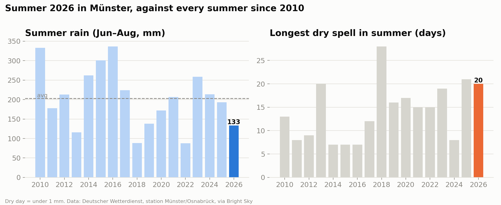
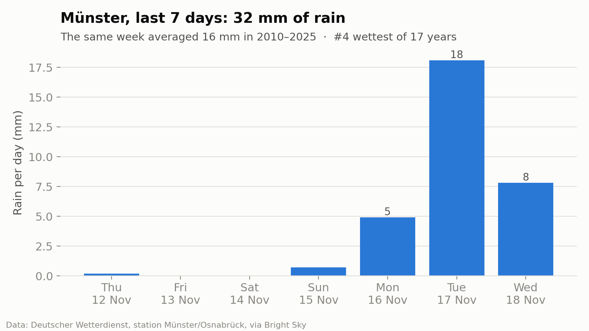

# Münster Water Extremes 🌧️☀️

An open, end-to-end tracker for **heavy rain and drought in Münster, Germany**, built on open data from the Deutscher Wetterdienst (DWD).

Yearly totals look normal while the extremes inside them grow. In 2026, Münster's year-to-date rainfall sat right at the long-term average, yet summer (Jun–Aug) brought only **133 mm, about a third below the 2010–2025 average**, with a 20-day dry spell. Then mid-November delivered **twice the usual rain in a single week**. This project tracks both ends, explains them in plain language, and will later warn about them.

<p align="center">
  
</p>
<p align="center">
  
</p>

## Status

🚧 Early build, developed in public.

- [x] Station rainfall 2010–today, daily totals with honest gaps (`notebooks/01_rain_and_drought_overview.ipynb`)
- [ ] Hourly ingestion pipeline (station + RADOLAN radar + ICON-D2 forecasts)
- [ ] Neighbourhood-level heavy-rain risk score (rain × terrain)
- [ ] Drought index (soil moisture, climatic water balance)
- [ ] Public API (FastAPI) + live map
- [ ] Plain-German alerts

## Architecture (planned)

```
DWD open data ──► ingestion jobs ──► storage ──► risk model ──► API ──► map + alerts
 station · RADOLAN radar    hourly       Parquet/Zarr   rain × terrain   FastAPI   web map,
 ICON-D2 · soil moisture                 + PostGIS      + drought index            plain-German text
```

## Quick start

```bash
python -m venv .venv && source .venv/bin/activate
pip install -r requirements.txt
jupyter notebook notebooks/01_rain_and_drought_overview.ipynb
```

The notebook fetches data from the free [Bright Sky API](https://brightsky.dev), caches it in `notebooks/data/cache/` (git-ignored) and writes charts to `notebooks/figures/`.

## Data & credit

Weather data: **Deutscher Wetterdienst (DWD)**, open data, accessed via Bright Sky. Station: Münster/Osnabrück (DWD ID 01766).

## License

Code: MIT. Data remains subject to DWD's terms of use.
